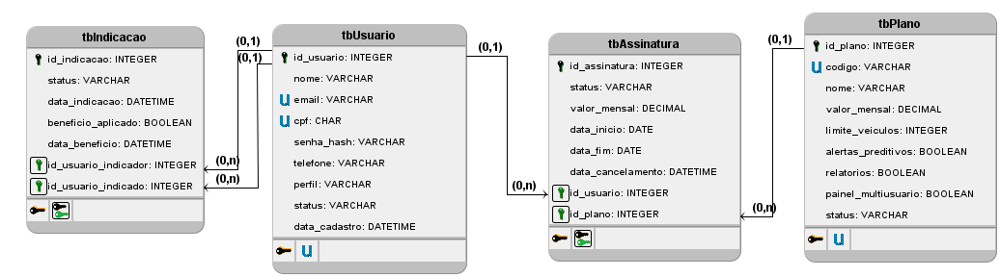
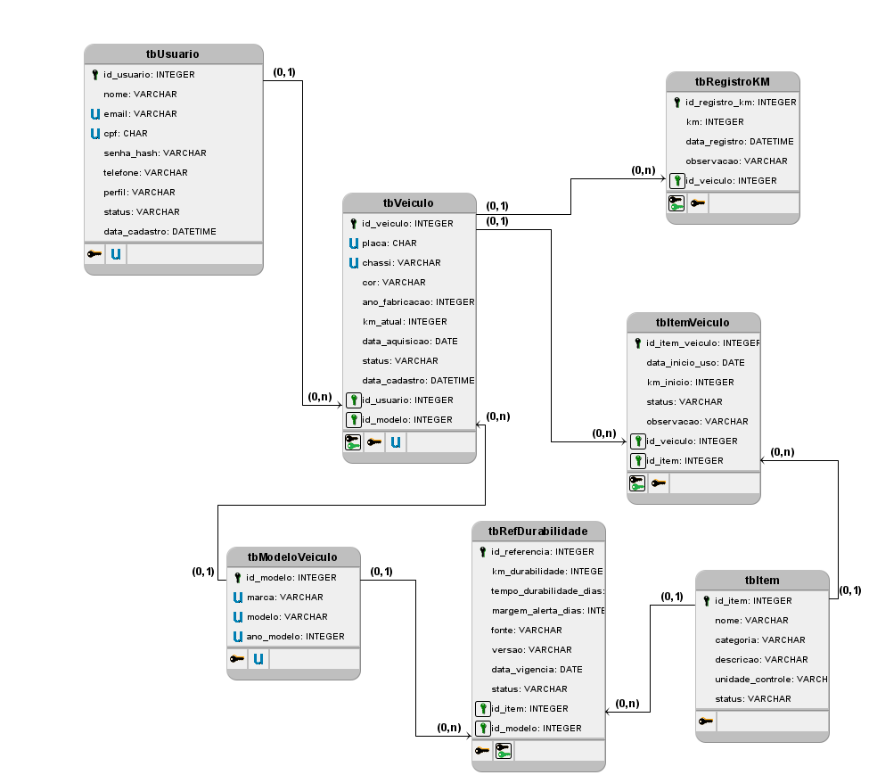
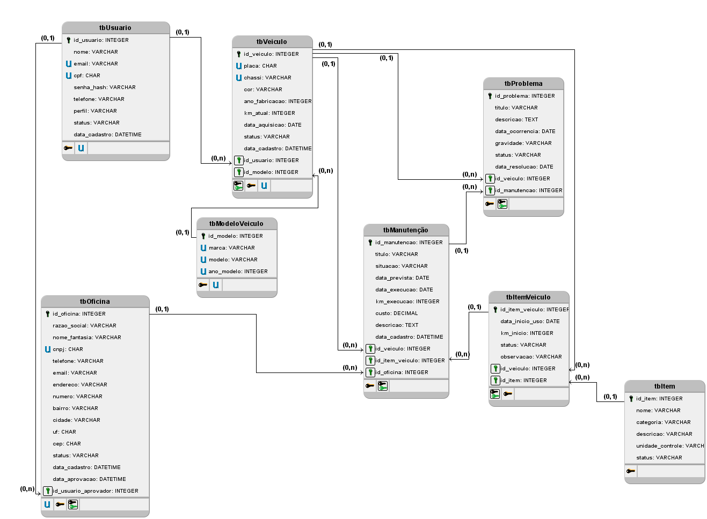
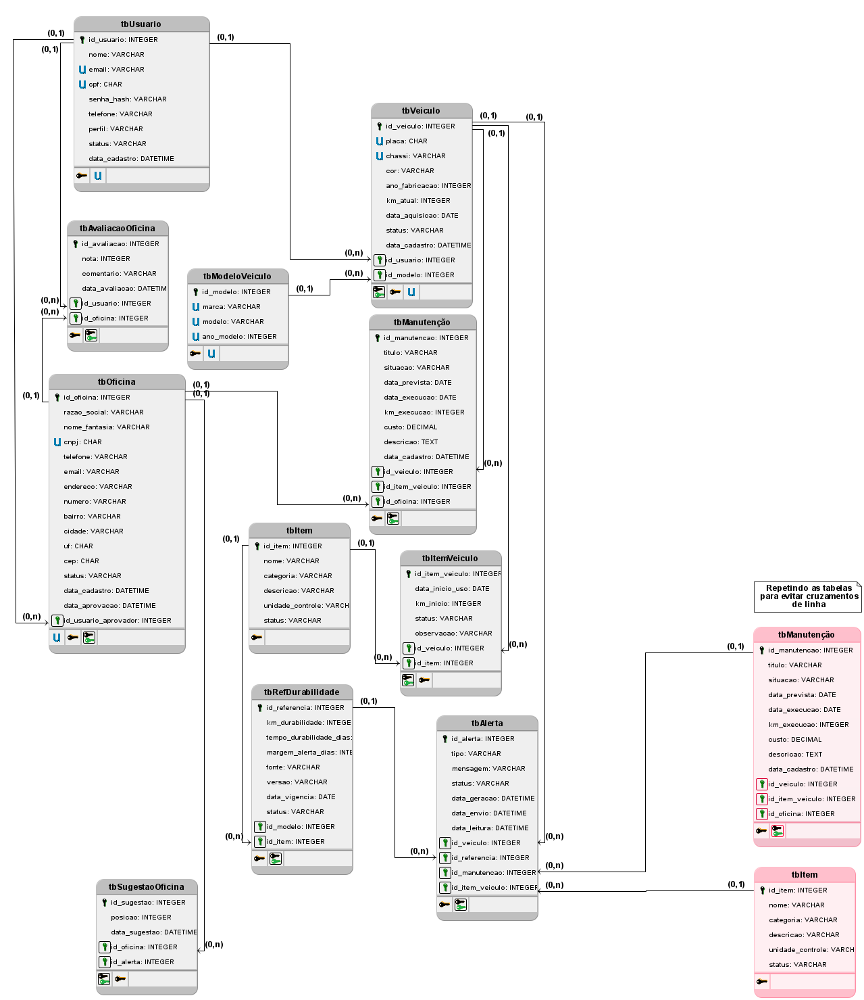

# MER e Dicionário de Dados — PreventCar

Este documento atende aos entregáveis da **Sprint 3**:

1. Identificação das **entidades**, dos **atributos** e dos **relacionamentos** necessários à solução;
2. **MER** (Modelo Entidade-Relacionamento), indicando identificadores e cardinalidades;
3. **Modelo lógico**, definindo tabelas, campos, chaves primárias e chaves estrangeiras;
4. **Dicionário de dados**, descrevendo os campos e suas características.

> **Escopo:** solução completa — MVP (usuários, veículos, itens, manutenções, problemas, alertas, quilometragem) + módulos de negócio previstos nos RF12–RF18 e RN01–RN07 (planos/assinaturas, indicações, oficinas parceiras, agendamentos e comissões).
>
> **Base de informação:** [REQUISITOS.md](./REQUISITOS.md), [CASOS_DE_USO.md](./CASOS_DE_USO.md), [SITEMAP_FLUXOS.md](./SITEMAP_FLUXOS.md) e os diagramas do [modelo lógico em `MER/`](./MER/).

---

## 1. Entidades, atributos e relacionamentos

### 1.1 Entidades identificadas

| # | Entidade | Identificador (PK) | Descrição | RF / RN |
|---|---|---|---|---|
| 1 | **USUARIO** | `id_usuario` | Pessoa física com conta no sistema. Concentra os perfis *Usuário* e *Administrador* (o administrador é um usuário com privilégio adicional — UC08/UC09). | RF01, RF19, RF18 |
| 2 | **PLANO** | `id_plano` | Catálogo dos níveis de assinatura (Free, Premium, Frota) e suas limitações. | RF12, RN01, RN02 |
| 3 | **ASSINATURA** | `id_assinatura` | Vínculo contratual entre um usuário e um plano, com status e vigência. Mantém o histórico de upgrade/downgrade/cancelamento. | RF12, RF13, RN02 |
| 4 | **INDICACAO** | `id_indicacao` | Registro do programa de indicação: usuário que indicou × usuário indicado e o benefício aplicado. | RF18, RN07 |
| 5 | **MODELO_VEICULO** | `id_modelo` | Referência de marca/modelo/ano, base para classificar veículos e associar referências de durabilidade. | RF05, RN01 (Frota) |
| 6 | **VEICULO** | `id_veiculo` | Automóvel cadastrado por um usuário, com placa, quilometragem atual e status ativo/inativo. | RF07, RF08, RF21 |
| 7 | **ITEM** | `id_item` | Catálogo de itens/peças monitoráveis (óleo, pastilhas, pneus…), com unidade de controle e status. | RF02, RF09 |
| 8 | **ITEM_VEICULO** | `id_item_veiculo` | *Instância* de um item monitorado em um veículo específico (instalação, km e data de início do uso). É o que efetivamente "tem tempo de uso". | RF03, RF09 |
| 9 | **REFERENCIA_DURABILIDADE** | `id_referencia` | Referência de durabilidade (km e/ou tempo) de um item para um modelo de veículo, com fonte e vigência. | RF05, RNF06, UC11 |
| 10 | **REGISTRO_QUILOMETRAGEM** | `id_registro_km` | Histórico cronológico das medições de quilometragem informadas pelo usuário. | RF21 |
| 11 | **MANUTENCAO** | `id_manutencao` | Registro de manutenção **pendente** ou **executada** de um veículo, com previsão, execução, custo e vínculo opcional com item e oficina. | RF06, RF10, RF20 |
| 12 | **PROBLEMA** | `id_problema` | Ocorrência/falha relatada no veículo (histórico de problemas), com gravidade e situação. | RF11 |
| 13 | **ALERTA** | `id_alerta` | Notificação automática gerada pelo Sistema de Notificação (antes, durante, após o prazo ou de pendência). | RF04, UC12, UC13 |
| 14 | **SUGESTAO_OFICINA** | `id_sugestao` | Associação entre um alerta e as oficinas parceiras sugeridas ao usuário (RN03). | RF04, RF16, RN03 |
| 15 | **OFICINA** | `id_oficina` | Oficina mecânica parceira, com dados cadastrais, CNPJ e status de aprovação. | RF14, RF15, RN05 |
| 16 | **AVALIACAO_OFICINA** | `id_avaliacao` | Nota e comentário deixados por um usuário para uma oficina parceira. | RF15 |
| 17 | **AGENDAMENTO** | `id_agendamento` | Marcação de serviço em oficina parceira, com data/hora, status do atendimento e valor do serviço. | RF16, RN03 |
| 18 | **COMISSAO** | `id_comissao` | Comissão percentual devida à PreventCar sobre um agendamento concluído na plataforma. | RF17, RN04 |

> **Fora do modelo (diretrizes, não estruturas):** RN06 (licenciamento de dados anonimizados a terceiros) não gera entidade — é derivável por consulta agregada sobre `REFERENCIA_DURABILIDADE`.

### 1.2 Atributos — síntese

Os atributos completos constam do [dicionário de dados (seção 6)](#6-dicionário-de-dados). A síntese abaixo destaca os **atributos identificadores** e os **atributos discriminadores/negócio** de cada entidade:

| Entidade | Atributos-chave |
|---|---|
| USUARIO | `nome`, `email` (único), `cpf` (único), `senha_hash`, `telefone`, `perfil`, `status`, `data_cadastro` |
| PLANO | `codigo` (FREE/PREMIUM/FROTA), `nome`, `valor_mensal`, `limite_veiculos`, `alertas_preditivos`, `relatorios`, `painel_multiusuario` |
| ASSINATURA | `id_usuario`, `id_plano`, `status`, `valor_mensal`, `data_inicio`, `data_fim`, `data_cancelamento` |
| INDICACAO | `id_usuario_indicador`, `id_usuario_indicado`, `status`, `data_indicacao`, `beneficio_aplicado` |
| MODELO_VEICULO | `marca`, `modelo`, `ano_modelo` |
| VEICULO | `placa` (única), `chassi` (único), `id_modelo`, `id_usuario`, `km_atual`, `cor`, `status`, `data_cadastro` |
| ITEM | `nome`, `categoria`, `unidade_controle`, `status` |
| ITEM_VEICULO | `id_veiculo`, `id_item`, `data_inicio_uso`, `km_inicio`, `status`, `observacao` |
| REFERENCIA_DURABILIDADE | `id_item`, `id_modelo`, `km_durabilidade`, `tempo_durabilidade_dias`, `margem_alerta_dias`, `fonte`, `vigencia` |
| REGISTRO_QUILOMETRAGEM | `id_veiculo`, `km`, `data_registro`, `observacao` |
| MANUTENCAO | `id_veiculo`, `id_item_veiculo`, `id_oficina`, `situacao`, `data_prevista`, `data_execucao`, `km_execucao`, `custo` |
| PROBLEMA | `id_veiculo`, `titulo`, `data_ocorrencia`, `gravidade`, `status` |
| ALERTA | `id_veiculo`, `id_item_veiculo`, `id_manutencao`, `tipo`, `status`, `mensagem`, `data_geracao` |
| SUGESTAO_OFICINA | `id_alerta`, `id_oficina`, `posicao`, `data_sugestao` |
| OFICINA | `cnpj` (único), `razao_social`, `nome_fantasia`, `endereco`, `cidade`, `uf`, `status` |
| AVALIACAO_OFICINA | `id_oficina`, `id_usuario`, `nota`, `comentario`, `data_avaliacao` |
| AGENDAMENTO | `id_usuario`, `id_veiculo`, `id_oficina`, `id_manutencao`, `data_hora`, `servico`, `status`, `valor_servico` |
| COMISSAO | `id_agendamento`, `percentual`, `valor_base`, `valor_comissao`, `status` |

### 1.3 Relacionamentos e cardinalidades

Cardinalidade escrita como **1 ↔ N** com leitura "para cada instância da entidade da esquerda, quantas da direita participam" (min, max).

| # | Relacionamento | Cardinalidade | Leitura | RF / RN |
|---|---|---|---|---|
| R01 | USUARIO → VEICULO | **1,1 → 0,N** | Um usuário possui de zero a N veículos; cada veículo pertence a exatamente um usuário. | RF07, RN02 |
| R02 | MODELO_VEICULO → VEICULO | **1,1 → 0,N** | Um modelo classifica N veículos; um veículo refere-se a exatamente um modelo. | RF05 |
| R03 | USUARIO → ASSINATURA | **1,1 → 0,N** | Um usuário pode nunca ter assinatura ou ter várias (histórico); cada assinatura é de um único usuário. No máximo **1 assinatura ATIVA** por usuário (regra de integridade). | RF12, RF13 |
| R04 | PLANO → ASSINATURA | **1,1 → 0,N** | Um plano é contratado em N assinaturas; cada assinatura referencia exatamente um plano. | RN01 |
| R05 | USUARIO → INDICACAO | **1,1 → 0,N** | Um usuário pode indicar N novos usuários. O campo `id_usuario_indicado` referencia o mesmo atributo identificador (papéis *indicador* e *indicado*); enquanto pendente, o indicado pode ainda não existir (0,1). | RF18, RN07 |
| R06 | VEICULO → ITEM_VEICULO | **1,1 → 0,N** | Um veículo monitora N itens; cada instância de item pertence a exatamente um veículo. | RF03, RF09 |
| R07 | ITEM → ITEM_VEICULO | **1,1 → 0,N** | Um item do catálogo instala-se em N veículos; cada instância refere-se a exatamente um item. | RF02 |
| R08 | ITEM → REFERENCIA_DURABILIDADE | **1,1 → 0,N** | Um item possui N referências de durabilidade (uma por modelo/vigência); cada referência é de um único item. | RF05 |
| R09 | MODELO_VEICULO → REFERENCIA_DURABILIDADE | **0,1 → 0,N** | A referência pode valer para um modelo específico ou, quando o modelo não é informado, para qualquer modelo (genérica). | RF05, RNF06 |
| R10 | VEICULO → REGISTRO_QUILOMETRAGEM | **1,1 → 0,N** | Um veículo acumula N registros de quilometragem; cada registro pertence a um único veículo. | RF21 |
| R11 | VEICULO → MANUTENCAO | **1,1 → 0,N** | Um veículo tem N manutenções (pendentes e executadas); cada manutenção pertence a um único veículo. | RF06, RF10, RF20 |
| R12 | ITEM_VEICULO → MANUTENCAO | **0,1 → 0,N** | Uma manutenção pode referir-se a um item monitorado específico ou não (manutenção geral do veículo). | RF03, RF10 |
| R13 | OFICINA → MANUTENCAO | **0,1 → 0,N** | A manutenção pode ter sido executada em uma oficina parceira ou fora da plataforma. | RF14, RN05 |
| R14 | VEICULO → ALERTA | **1,1 → 0,N** | Todo alerta é emitido para um veículo; um veículo recebe N alertas. | RF04, UC12 |
| R15 | ITEM_VEICULO → ALERTA | **0,1 → 0,N** | O alerta pode estar vinculado ao desgaste de um item monitorado (alertas de durabilidade). | RF03, RF04 |
| R16 | MANUTENCAO → ALERTA | **0,1 → 0,N** | Alertas de pendência referem-se a uma manutenção ainda não executada. | RF10, RF04 |
| R17 | ALERTA → SUGESTAO_OFICINA | **1,1 → 0,N** | Um alerta pode sugerir N oficinas (ordenadas); cada sugestão pertence a exatamente um alerta. | RN03 |
| R18 | OFICINA → SUGESTAO_OFICINA | **1,1 → 0,N** | Uma oficina aprovada pode ser sugerida em N alertas. | RN05 |
| R19 | VEICULO → PROBLEMA | **1,1 → 0,N** | Um veículo apresenta N problemas; cada problema pertence a um único veículo. | RF11 |
| R20 | MANUTENCAO → PROBLEMA | **0,1 → 0,N** | Um problema pode estar vinculado à manutenção que o resolveu. | RF11, RF20 |
| R21 | USUARIO → AGENDAMENTO | **1,1 → 0,N** | Um usuário realiza N agendamentos; cada agendamento é de um único usuário. | RF16 |
| R22 | VEICULO → AGENDAMENTO | **1,1 → 0,N** | Um agendamento envolve exatamente um veículo. | RF16 |
| R23 | OFICINA → AGENDAMENTO | **1,1 → 0,N** | Uma oficina aprovada recebe N agendamentos (RN05 impede oficina não aprovada). | RF16, RN05 |
| R24 | ALERTA → AGENDAMENTO | **0,1 → 0,N** | O agendamento pode ter origem em um alerta sugerido (gatilho da sugestão). | RN03 |
| R25 | MANUTENCAO → AGENDAMENTO | **0,1 → 0,N** | O agendamento pode originar a manutenção executada (vinculação agendamento ↔ execução). | RF16, RF20 |
| R26 | AGENDAMENTO → COMISSAO | **1,1 → 0,1** | Um agendamento concluído e sugerido gera no máximo **uma** comissão; comissão sempre existe para um único agendamento. | RF17, RN04 |
| R27 | OFICINA → AVALIACAO_OFICINA | **1,1 → 0,N** | Uma oficina recebe N avaliações; cada avaliação é para uma única oficina. | RF15 |
| R28 | USUARIO → AVALIACAO_OFICINA | **1,1 → 0,N** | Um usuário emite N avaliações; cada avaliação é de um único usuário. | RF15 |

---

## 2. MER — Modelo Entidade-Relacionamento

O MER/modelo lógico está documentado nos quatro diagramas da pasta [`MER/`](./MER/):









**Observações sobre o diagrama:**

- A entidade **INDICACAO** participa de **dois papéis** junto a USUARIO (`id_usuario_indicador` e `id_usuario_indicado`). No diagrama o relacionamento é representado uma única vez (papel *indicador*) para evitar duplicidade de aresta; os dois apontamentos estão explicitados em R05 e no modelo lógico.
- **MANUTENCAO** cobre RF10 (pendente) e RF20 (executada) por meio do atributo `situacao`, evitando duas entidades paralelas com o mesmo significado.
- **ITEM** (catálogo, RF02) é separado de **ITEM_VEICULO** (instância monitorada) porque o mesmo item — "pastilha de freio dianteira" — existe em vários veículos com tempos de uso distintos (RF03).
- **REFERENCIA_DURABILIDADE** está ligada a MODELO_VEICULO (e não diretamente a VEICULO) porque a durabilidade é característica do item no modelo do veículo; o veículo acessa a referência via `id_modelo` — o que satisfaz a exigência de associação "veículo × item" do RF05.

---

## 3. Modelo lógico

Transformação das entidades em **tabelas**, dos atributos em **campos**, com chaves primárias (PK) e chaves estrangeiras (FK).

### 3.1 Esquema relacional

Notação: `**id**` = chave primária (PK), `*id*` = chave estrangeira (FK), `UK` = chave alternativa (única).

```
PLANO                (**id_plano**, codigo UK, nome, valor_mensal, limite_veiculos,
                      alertas_preditivos, relatorios, painel_multiusuario, status)

USUARIO              (**id_usuario**, nome, email UK, cpf UK, senha_hash, telefone,
                      perfil, status, data_cadastro)

ASSINATURA           (**id_assinatura**, *id_usuario*, *id_plano*, status, valor_mensal,
                      data_inicio, data_fim, data_cancelamento)

INDICACAO            (**id_indicacao**, *id_usuario_indicador*, *id_usuario_indicado*,
                      status, data_indicacao, beneficio_aplicado, data_beneficio)

MODELO_VEICULO       (**id_modelo**, marca UK*, modelo UK*, ano_modelo UK*)

VEICULO              (**id_veiculo**, *id_usuario*, *id_modelo*, placa UK, chassi UK,
                      cor, ano_fabricacao, km_atual, data_aquisicao, status,
                      data_cadastro)

ITEM                 (**id_item**, nome, categoria, descricao, unidade_controle, status)

ITEM_VEICULO         (**id_item_veiculo**, *id_veiculo*, *id_item*, data_inicio_uso,
                      km_inicio, status, observacao)

REFERENCIA_DURABILIDADE (**id_referencia**, *id_item*, *id_modelo*, km_durabilidade,
                      tempo_durabilidade_dias, margem_alerta_dias, fonte, versao,
                      data_vigencia, status)

REGISTRO_QUILOMETRAGEM (**id_registro_km**, *id_veiculo*, km, data_registro, observacao)

MANUTENCAO           (**id_manutencao**, *id_veiculo*, *id_item_veiculo*, *id_oficina*,
                      titulo, situacao, data_prevista, data_execucao, km_execucao,
                      custo, descricao, data_cadastro)

PROBLEMA             (**id_problema**, *id_veiculo*, *id_manutencao*, titulo, descricao,
                      data_ocorrencia, gravidade, status, data_resolucao)

ALERTA               (**id_alerta**, *id_veiculo*, *id_item_veiculo*, *id_referencia*,
                      *id_manutencao*, tipo, mensagem, status, data_geracao,
                      data_envio, data_leitura)

SUGESTAO_OFICINA     (**id_sugestao**, *id_alerta*, *id_oficina*, posicao, data_sugestao)

OFICINA              (**id_oficina**, razao_social, nome_fantasia, cnpj UK, telefone,
                      email, endereco, numero, bairro, cidade, uf, cep, status,
                      data_cadastro, data_aprovacao, *id_usuario_aprovador*)

AVALIACAO_OFICINA    (**id_avaliacao**, *id_oficina*, *id_usuario*, nota, comentario,
                      data_avaliacao)

AGENDAMENTO          (**id_agendamento**, *id_usuario*, *id_veiculo*, *id_oficina*,
                      *id_manutencao*, *id_alerta*, data_hora, servico, status,
                      valor_servico, data_conclusao, observacao, data_cadastro)

COMISSAO             (**id_comissao**, *id_agendamento* UK, percentual, valor_base,
                      valor_comissao, status, data_registro)
```

> `UK*` em `MODELO_VEICULO` indica chave única **composta** de (`marca`, `modelo`, `ano_modelo`).

### 3.2 Tabelas, PK e FK

| Tabela | Chave primária (PK) | Chaves estrangeiras (FK) → tabela referenciada |
|---|---|---|
| `PLANO` | `id_plano` | — |
| `USUARIO` | `id_usuario` | — |
| `ASSINATURA` | `id_assinatura` | `id_usuario` → `USUARIO`, `id_plano` → `PLANO` |
| `INDICACAO` | `id_indicacao` | `id_usuario_indicador` → `USUARIO`, `id_usuario_indicado` → `USUARIO` |
| `MODELO_VEICULO` | `id_modelo` | — |
| `VEICULO` | `id_veiculo` | `id_usuario` → `USUARIO`, `id_modelo` → `MODELO_VEICULO` |
| `ITEM` | `id_item` | — |
| `ITEM_VEICULO` | `id_item_veiculo` | `id_veiculo` → `VEICULO`, `id_item` → `ITEM` |
| `REFERENCIA_DURABILIDADE` | `id_referencia` | `id_item` → `ITEM`, `id_modelo` → `MODELO_VEICULO` (opcional) |
| `REGISTRO_QUILOMETRAGEM` | `id_registro_km` | `id_veiculo` → `VEICULO` |
| `MANUTENCAO` | `id_manutencao` | `id_veiculo` → `VEICULO`, `id_item_veiculo` → `ITEM_VEICULO` (opcional), `id_oficina` → `OFICINA` (opcional) |
| `PROBLEMA` | `id_problema` | `id_veiculo` → `VEICULO`, `id_manutencao` → `MANUTENCAO` (opcional) |
| `ALERTA` | `id_alerta` | `id_veiculo` → `VEICULO`, `id_item_veiculo` → `ITEM_VEICULO` (opcional), `id_referencia` → `REFERENCIA_DURABILIDADE` (opcional), `id_manutencao` → `MANUTENCAO` (opcional) |
| `SUGESTAO_OFICINA` | `id_sugestao` | `id_alerta` → `ALERTA`, `id_oficina` → `OFICINA` |
| `OFICINA` | `id_oficina` | `id_usuario_aprovador` → `USUARIO` (opcional) |
| `AVALIACAO_OFICINA` | `id_avaliacao` | `id_oficina` → `OFICINA`, `id_usuario` → `USUARIO` |
| `AGENDAMENTO` | `id_agendamento` | `id_usuario` → `USUARIO`, `id_veiculo` → `VEICULO`, `id_oficina` → `OFICINA`, `id_manutencao` → `MANUTENCAO` (opcional), `id_alerta` → `ALERTA` (opcional) |
| `COMISSAO` | `id_comissao` | `id_agendamento` → `AGENDAMENTO` |

### 3.3 Chaves alternativas (UK) e regras de integridade

| Tabela | Unicidade | Regra |
|---|---|---|
| `USUARIO` | `email`, `cpf` | Login único (RF19); CPF opcional, mas único quando preenchido. |
| `PLANO` | `codigo` | Identificação estável dos planos FREE/PREMIUM/FROTA (RN01). |
| `VEICULO` | `placa`, `chassi` | Um mesmo veículo não pode ser cadastrado duas vezes. |
| `MODELO_VEICULO` | (`marca`, `modelo`, `ano_modelo`) | Evita duplicidade de referência de durabilidade. |
| `ASSINATURA` | — | **No máximo 1 registro com `status = 'ATIVA'` por usuário** (RF13 — upgrade/downgrade gera novo registro e encerra o anterior). |
| `INDICACAO` | (`id_usuario_indicador`, `id_usuario_indicado`) | Um usuário indica outro no máximo uma vez. |
| `SUGESTAO_OFICINA` | (`id_alerta`, `id_oficina`) | A mesma oficina não é sugerida duas vezes no mesmo alerta; `posicao` define a ordem de exibição. |
| `COMISSAO` | `id_agendamento` | Relação **1:1** — uma comissão por agendamento (RN04). |
| `MANUTENCAO` | — | `situacao = 'EXECUTADA'` exige `data_execucao` não nula (RF20); `situacao = 'PENDENTE'` exige `data_prevista` (RF10). |
| `OFICINA` | `cnpj` | CNPJ único por parceiro (RN05). |
| `REFERENCIA_DURABILIDADE` | (`id_item`, `id_modelo`, `data_vigencia`) | Uma vigência vigente por item/modelo; `CHECK (km_durabilidade IS NOT NULL OR tempo_durabilidade_dias IS NOT NULL)` (RF05 — em km e/ou tempo). |
| `REGISTRO_QUILOMETRAGEM` | — | `km` sempre maior que o registro anterior do mesmo veículo (monotonicidade). |

**Integridade referencial e de exclusão (RF08/RF09):** a exclusão é sempre **lógica**. Veículos e itens são marcados com `status = 'INATIVO'`; os registros históricos (`MANUTENCAO`, `PROBLEMA`, `ALERTA`, `REGISTRO_QUILOMETRAGEM`) permanecem intactos — nenhuma chave estrangeira admite `ON DELETE CASCADE` sobre essas tabelas.

---

## 4. Rastreabilidade requisitos → entidades

| Requisito | Entidades envolvidas |
|---|---|
| RF01, RF19 (cadastro/autenticação) | `USUARIO` |
| RF02, RF09 (cadastro/inativação de itens) | `ITEM`, `ITEM_VEICULO` |
| RF03 (tempo de uso do item) | `ITEM_VEICULO`, `VEICULO` (`km_atual`) |
| RF04 (alertas antes/durante/após) | `ALERTA`, `SUGESTAO_OFICINA` |
| RF05 (referência de durabilidade) | `REFERENCIA_DURABILIDADE`, `ITEM`, `MODELO_VEICULO` |
| RF06, RF20 (histórico/manutenção executada) | `MANUTENCAO`, `VEICULO`, `OFICINA` |
| RF07, RF08 (cadastro/inativação de veículos) | `VEICULO`, `MODELO_VEICULO` |
| RF10 (manutenções pendentes) | `MANUTENCAO` (`situacao = 'PENDENTE'`), `ALERTA` |
| RF11 (histórico de problemas) | `PROBLEMA` |
| RF12, RF13, RN01, RN02 (planos/assinatura) | `PLANO`, `ASSINATURA` |
| RF14, RF15, RN05 (oficinas parceiras) | `OFICINA`, `AVALIACAO_OFICINA` |
| RF16, RN03 (agendamento/sugestão) | `AGENDAMENTO`, `ALERTA`, `SUGESTAO_OFICINA` |
| RF17, RN04 (comissão) | `COMISSAO`, `AGENDAMENTO` |
| RF18, RN07 (indicação) | `INDICACAO`, `USUARIO` |
| RF21 (quilometragem) | `REGISTRO_QUILOMETRAGEM`, `VEICULO` |
| RNF01 (segurança de credenciais) | `USUARIO.senha_hash` |
| RNF06 (fonte confiável de durabilidade) | `REFERENCIA_DURABILIDADE.fonte` |
| RN06 (dados anonimizados) | — (derivado, sem entidade) |
| UC11, UC12, UC13 (Sistema de Notificação) | `REFERENCIA_DURABILIDADE`, `ALERTA` |

---

## 5. Conformidade com a Sprint 3

| Item da SP3 | Onde está |
|---|---|
| Entidades, atributos e relacionamentos | Seção 1 |
| MER com identificadores e cardinalidades | Seção 2 (diagrama) + seção 1.3 (cardinalidades detalhadas) |
| Modelo lógico: tabelas, campos, PK e FK | Seção 3 |
| Dicionário de dados | Seção 6 |

---

## 6. Dicionário de dados

**Legenda das colunas**

- **Tipo/tamanho:** tipo de dado lógico e capacidade máxima.
- **Nulo?**: `Sim` = aceita valor nulo; `Não` = obrigatório.
- **Chave:** `PK` = primária, `FK` = estrangeira, `UK` = única (alternativa).

### 6.1 `USUARIO`

| Campo | Tipo/tamanho | Nulo? | Chave | Descrição e domínio |
|---|---|---|---|---|
| `id_usuario` | INT (auto) | Não | PK | Identificador único do usuário. |
| `nome` | VARCHAR(120) | Não | | Nome completo do usuário. |
| `email` | VARCHAR(150) | Não | UK | E-mail usado no login (RF19). |
| `cpf` | CHAR(11) | Sim | UK | CPF somente dígitos; opcional, mas único quando informado. |
| `senha_hash` | VARCHAR(255) | Não | | Senha armazenada **apenas em hash** (RNF01); nunca em texto puro. |
| `telefone` | VARCHAR(20) | Sim | | Telefone/WhatsApp com DDD, para notificações (ex.: `11987654321`). |
| `perfil` | VARCHAR(20) | Não | | `USUARIO` ou `ADMINISTRADOR` (padrão `USUARIO`). Define privilégios de UC08–UC10. |
| `status` | VARCHAR(15) | Não | | `ATIVO`, `INATIVO`, `BLOQUEADO` (padrão `ATIVO`). |
| `data_cadastro` | DATETIME | Não | | Data/hora da criação da conta. |

### 6.2 `PLANO`

| Campo | Tipo/tamanho | Nulo? | Chave | Descrição e domínio |
|---|---|---|---|---|
| `id_plano` | INT (auto) | Não | PK | Identificador do plano. |
| `codigo` | VARCHAR(10) | Não | UK | `FREE`, `PREMIUM`, `FROTA` (RN01). |
| `nome` | VARCHAR(60) | Não | | Nome de exibição (ex.: "Premium Anual"). |
| `valor_mensal` | DECIMAL(10,2) | Não | | Preço mensal em R$; `0.00` para o plano Free. |
| `limite_veiculos` | INT | Sim | | Máximo de veículos ativos por usuário; `NULL` = ilimitado (RN01/RN02). |
| `alertas_preditivos` | BOOLEAN | Não | | `true` se o plano oferece alertas preditivos (RN01). |
| `relatorios` | BOOLEAN | Não | | `true` se inclui relatórios/exportação (RN01). |
| `painel_multiusuario` | BOOLEAN | Não | | `true` para o painel multiusuário da Frota (RN01). |
| `status` | VARCHAR(10) | Não | | `ATIVO` ou `INATIVO` (plano disponível para nova contratação). |

### 6.3 `ASSINATURA`

| Campo | Tipo/tamanho | Nulo? | Chave | Descrição e domínio |
|---|---|---|---|---|
| `id_assinatura` | INT (auto) | Não | PK | Identificador da assinatura. |
| `id_usuario` | INT | Não | FK → `USUARIO` | Titular da assinatura. |
| `id_plano` | INT | Não | FK → `PLANO` | Plano contratado. |
| `status` | VARCHAR(15) | Não | | `ATIVA`, `SUSPENSA`, `CANCELADA` (RF13). |
| `valor_mensal` | DECIMAL(10,2) | Não | | Valor congelado no momento da contratação (histórico). |
| `data_inicio` | DATE | Não | | Início da vigência. |
| `data_fim` | DATE | Sim | | Término previsto; `NULL` = vigência contínua. |
| `data_cancelamento` | DATETIME | Sim | | Data/hora do cancelamento (RF13). |

### 6.4 `INDICACAO`

| Campo | Tipo/tamanho | Nulo? | Chave | Descrição e domínio |
|---|---|---|---|---|
| `id_indicacao` | INT (auto) | Não | PK | Identificador da indicação. |
| `id_usuario_indicador` | INT | Não | FK → `USUARIO` | Usuário Premium que indicou (RF18). |
| `id_usuario_indicado` | INT | Sim | FK → `USUARIO` | Usuário indicado; `NULL` enquanto o convite não for aceito. |
| `status` | VARCHAR(15) | Não | | `PENDENTE`, `ACEITA`, `REJEITADA`. |
| `data_indicacao` | DATETIME | Não | | Data/hora da indicação. |
| `beneficio_aplicado` | BOOLEAN | Não | | `true` quando o benefício comercial foi aplicado (RN07). Padrão `false`. |
| `data_beneficio` | DATETIME | Sim | | Data/hora da aplicação do benefício. |

### 6.5 `MODELO_VEICULO`

| Campo | Tipo/tamanho | Nulo? | Chave | Descrição e domínio |
|---|---|---|---|---|
| `id_modelo` | INT (auto) | Não | PK | Identificador do modelo. |
| `marca` | VARCHAR(60) | Não | CParte UK | Marca do veículo (ex.: `FIAT`). |
| `modelo` | VARCHAR(80) | Não | CParte UK | Nome do modelo (ex.: `ARGO`). |
| `ano_modelo` | INT | Não | CParte UK | Ano-modelo de referência (ex.: `2024`). |

> Chave única composta: (`marca`, `modelo`, `ano_modelo`).

### 6.6 `VEICULO`

| Campo | Tipo/tamanho | Nulo? | Chave | Descrição e domínio |
|---|---|---|---|---|
| `id_veiculo` | INT (auto) | Não | PK | Identificador do veículo. |
| `id_usuario` | INT | Não | FK → `USUARIO` | Proprietário/ responsável (R01). |
| `id_modelo` | INT | Não | FK → `MODELO_VEICULO` | Modelo que classifica o veículo (base do RF05). |
| `placa` | CHAR(7) | Não | UK | Placa Mercosul, sem hífen (ex.: `ABC1D23`). |
| `chassi` | VARCHAR(17) | Sim | UK | Número do chassi; único quando informado. |
| `cor` | VARCHAR(30) | Sim | | Cor principal do veículo. |
| `ano_fabricacao` | INT | Sim | | Ano de fabricação (4 dígitos). |
| `km_atual` | INT | Não | | Última quilometragem informada (RF21). Padrão `0`, `CHECK >= 0`. |
| `data_aquisicao` | DATE | Sim | | Data de aquisição pelo usuário. |
| `status` | VARCHAR(10) | Não | | `ATIVO` ou `INATIVO` (RF08 — inativação preserva histórico). Padrão `ATIVO`. |
| `data_cadastro` | DATETIME | Não | | Data/hora do cadastro. |

### 6.7 `ITEM`

| Campo | Tipo/tamanho | Nulo? | Chave | Descrição e domínio |
|---|---|---|---|---|
| `id_item` | INT (auto) | Não | PK | Identificador do item/peça. |
| `nome` | VARCHAR(100) | Não | | Nome do item (ex.: `Óleo do motor`, `Pastilha de freio dianteira`). |
| `categoria` | VARCHAR(60) | Não | | Agrupamento (ex.: `MOTOR`, `FREIOS`, `PNEUS`, `SUSPENSÃO`, `FILTRAGEM`). |
| `descricao` | VARCHAR(255) | Sim | | Especificação complementar. |
| `unidade_controle` | VARCHAR(12) | Não | | `KM`, `TEMPO` ou `KM_TEMPO` — critério de durabilidade do item (RF05). |
| `status` | VARCHAR(10) | Não | | `ATIVO` ou `INATIVO` (RF09 — inativação sem perda do histórico). |

### 6.8 `ITEM_VEICULO`

| Campo | Tipo/tamanho | Nulo? | Chave | Descrição e domínio |
|---|---|---|---|---|
| `id_item_veiculo` | INT (auto) | Não | PK | Identificador da instância do item no veículo. |
| `id_veiculo` | INT | Não | FK → `VEICULO` | Veículo que monitora o item. |
| `id_item` | INT | Não | FK → `ITEM` | Item do catálogo instalado. |
| `data_inicio_uso` | DATE | Não | | Data de início do uso — base do **tempo de uso** (RF03). |
| `km_inicio` | INT | Não | | Quilometragem na instalação — base do **uso em km** (RF03). |
| `status` | VARCHAR(10) | Não | | `ATIVO` ou `INATIVO` (RF09). Só pode existir um registro `ATIVO` por (`id_veiculo`,`id_item`). |
| `observacao` | VARCHAR(255) | Sim | | Observação livre (marca, lote, nota técnica). |

> **Tempo de uso (RF03)** = `hoje − data_inicio_uso`; **uso em km** = `VEICULO.km_atual − km_inicio`. Ambos são derivados, evitando duplicidade de dados.

### 6.9 `REFERENCIA_DURABILIDADE`

| Campo | Tipo/tamanho | Nulo? | Chave | Descrição e domínio |
|---|---|---|---|---|
| `id_referencia` | INT (auto) | Não | PK | Identificador da referência. |
| `id_item` | INT | Não | FK → `ITEM` | Item monitorado. |
| `id_modelo` | INT | Sim | FK → `MODELO_VEICULO` | Modelo de aplicação; `NULL` = referência vale para qualquer modelo. |
| `km_durabilidade` | INT | Sim | | Durabilidade esperada em quilômetros (RF05). |
| `tempo_durabilidade_dias` | INT | Sim | | Durabilidade esperada em dias (RF05). Ao menos um dos dois deve ser preenchido. |
| `margem_alerta_dias` | INT | Não | | Antecedência, em dias, do alerta "antes do prazo" (RF04). Padrão `0`. |
| `fonte` | VARCHAR(120) | Não | | Origem do dado (manual, fabricante, tabela interna) — RNF06. |
| `versao` | VARCHAR(20) | Sim | | Versão do conjunto de referências. |
| `data_vigencia` | DATE | Não | | Início de vigência da referência. |
| `status` | VARCHAR(10) | Não | | `ATIVA` ou `INATIVA`. |

### 6.10 `REGISTRO_QUILOMETRAGEM`

| Campo | Tipo/tamanho | Nulo? | Chave | Descrição e domínio |
|---|---|---|---|---|
| `id_registro_km` | INT (auto) | Não | PK | Identificador do registro. |
| `id_veiculo` | INT | Não | FK → `VEICULO` | Veículo medido. |
| `km` | INT | Não | | Quilometragem informada; `CHECK >= 0` e maior que o registro anterior (RF21). |
| `data_registro` | DATETIME | Não | | Data/hora da medição. |
| `observacao` | VARCHAR(255) | Sim | | Contexto da medição (ex.: "revisão dos 40 mil"). |

### 6.11 `MANUTENCAO`

| Campo | Tipo/tamanho | Nulo? | Chave | Descrição e domínio |
|---|---|---|---|---|
| `id_manutencao` | INT (auto) | Não | PK | Identificador da manutenção. |
| `id_veiculo` | INT | Não | FK → `VEICULO` | Veículo atendido. |
| `id_item_veiculo` | INT | Sim | FK → `ITEM_VEICULO` | Item monitorado envolvido; `NULL` para manutenção geral. |
| `id_oficina` | INT | Sim | FK → `OFICINA` | Oficina que executou; `NULL` quando executada pelo próprio usuário. |
| `titulo` | VARCHAR(120) | Não | | Resumo da manutenção (ex.: "Troca de óleo e filtro"). |
| `situacao` | VARCHAR(15) | Não | | `PENDENTE` (RF10), `EXECUTADA` (RF20), `ATRASADA`, `CANCELADA`. |
| `data_prevista` | DATE | Condicional | | Data prevista; obrigatória quando `PENDENTE`. |
| `data_execucao` | DATE | Condicional | | Data efetiva; obrigatória quando `EXECUTADA`. |
| `km_execucao` | INT | Sim | | Quilometragem no momento da execução. |
| `custo` | DECIMAL(10,2) | Sim | | Custo total em R$ da manutenção (único dado financeiro do MVP). |
| `descricao` | TEXT | Sim | | Detalhamento dos serviços e peças. |
| `data_cadastro` | DATETIME | Não | | Data/hora do registro. |

### 6.12 `PROBLEMA`

| Campo | Tipo/tamanho | Nulo? | Chave | Descrição e domínio |
|---|---|---|---|---|
| `id_problema` | INT (auto) | Não | PK | Identificador do problema. |
| `id_veiculo` | INT | Não | FK → `VEICULO` | Veículo afetado. |
| `id_manutencao` | INT | Sim | FK → `MANUTENCAO` | Manutenção que resolveu o problema. |
| `titulo` | VARCHAR(120) | Não | | Resumo da ocorrência. |
| `descricao` | TEXT | Sim | | Detalhamento do sintoma/falha. |
| `data_ocorrencia` | DATE | Não | | Data em que o problema foi percebido. |
| `gravidade` | VARCHAR(10) | Não | | `BAIXA`, `MEDIA`, `ALTA`, `CRITICA`. |
| `status` | VARCHAR(10) | Não | | `ABERTO` ou `RESOLVIDO`. |
| `data_resolucao` | DATE | Sim | | Data de encerramento. |

### 6.13 `ALERTA`

| Campo | Tipo/tamanho | Nulo? | Chave | Descrição e domínio |
|---|---|---|---|---|
| `id_alerta` | INT (auto) | Não | PK | Identificador do alerta. |
| `id_veiculo` | INT | Não | FK → `VEICULO` | Veículo notificado. |
| `id_item_veiculo` | INT | Sim | FK → `ITEM_VEICULO` | Item cujo desgaste disparou o alerta. |
| `id_referencia` | INT | Sim | FK → `REFERENCIA_DURABILIDADE` | Referência usada no cálculo (rastreabilidade do RF05). |
| `id_manutencao` | INT | Sim | FK → `MANUTENCAO` | Manutenção pendente relacionada (RF10). |
| `tipo` | VARCHAR(15) | Não | | `ANTES_DO_PRAZO`, `NO_PRAZO`, `APOS_O_PRAZO` (RF04) ou `PENDENCIA` (RF10). |
| `mensagem` | VARCHAR(255) | Não | | Texto exibido ao usuário. |
| `status` | VARCHAR(15) | Não | | `ATIVO`, `ENVIADO`, `RESOLVIDO`, `DESCARTADO`. Padrão `ATIVO`. |
| `data_geracao` | DATETIME | Não | | Data/hora de geração pelo Sistema de Notificação (UC12). |
| `data_envio` | DATETIME | Sim | | Data/hora do envio da notificação. |
| `data_leitura` | DATETIME | Sim | | Data/hora de visualização/confirmação pelo usuário (UC13). |

### 6.14 `SUGESTAO_OFICINA`

| Campo | Tipo/tamanho | Nulo? | Chave | Descrição e domínio |
|---|---|---|---|---|
| `id_sugestao` | INT (auto) | Não | PK | Identificador da sugestão. |
| `id_alerta` | INT | Não | FK → `ALERTA` | Alerta que originou a sugestão (RN03). |
| `id_oficina` | INT | Não | FK → `OFICINA` | Oficina parceira sugerida. |
| `posicao` | INT | Não | | Ordem de exibição (1 = primeira sugestão). |
| `data_sugestao` | DATETIME | Não | | Data/hora da sugestão. |

### 6.15 `OFICINA`

| Campo | Tipo/tamanho | Nulo? | Chave | Descrição e domínio |
|---|---|---|---|---|
| `id_oficina` | INT (auto) | Não | PK | Identificador da oficina. |
| `razao_social` | VARCHAR(120) | Não | | Razão social da empresa. |
| `nome_fantasia` | VARCHAR(120) | Sim | | Nome de exibição. |
| `cnpj` | CHAR(14) | Não | UK | CNPJ somente dígitos (RN05). |
| `telefone` | VARCHAR(20) | Não | | Telefone comercial com DDD. |
| `email` | VARCHAR(150) | Sim | | E-mail de contato. |
| `endereco` | VARCHAR(150) | Não | | Logradouro. |
| `numero` | VARCHAR(10) | Não | | Número. |
| `bairro` | VARCHAR(80) | Sim | | Bairro. |
| `cidade` | VARCHAR(80) | Não | | Cidade. |
| `uf` | CHAR(2) | Não | | Unidade federativa (2 letras). |
| `cep` | CHAR(8) | Sim | | CEP somente dígitos. |
| `status` | VARCHAR(15) | Não | | `CADASTRADA`, `APROVADA`, `INATIVA` (RF15/RN05 — só `APROVADA` recebe agendamentos). Padrão `CADASTRADA`. |
| `data_cadastro` | DATETIME | Não | | Data/hora do cadastro (RF14). |
| `data_aprovacao` | DATETIME | Sim | | Data/hora da aprovação pelo administrador. |
| `id_usuario_aprovador` | INT | Sim | FK → `USUARIO` | Administrador que aprovou (auditoria — RF15). |

### 6.16 `AVALIACAO_OFICINA`

| Campo | Tipo/tamanho | Nulo? | Chave | Descrição e domínio |
|---|---|---|---|---|
| `id_avaliacao` | INT (auto) | Não | PK | Identificador da avaliação. |
| `id_oficina` | INT | Não | FK → `OFICINA` | Oficina avaliada. |
| `id_usuario` | INT | Não | FK → `USUARIO` | Usuário que avaliou. |
| `nota` | INT | Não | | Nota de 1 a 5 (`CHECK BETWEEN 1 AND 5`). |
| `comentario` | VARCHAR(500) | Sim | | Comentário opcional. |
| `data_avaliacao` | DATETIME | Não | | Data/hora da avaliação. |

### 6.17 `AGENDAMENTO`

| Campo | Tipo/tamanho | Nulo? | Chave | Descrição e domínio |
|---|---|---|---|---|
| `id_agendamento` | INT (auto) | Não | PK | Identificador do agendamento. |
| `id_usuario` | INT | Não | FK → `USUARIO` | Usuário que agendou (RF16). |
| `id_veiculo` | INT | Não | FK → `VEICULO` | Veículo a ser atendido. |
| `id_oficina` | INT | Não | FK → `OFICINA` | Oficina escolhida/sugerida; deve estar `APROVADA` (RN05). |
| `id_manutencao` | INT | Sim | FK → `MANUTENCAO` | Manutenção vinculada a este atendimento. |
| `id_alerta` | INT | Sim | FK → `ALERTA` | Alerta que sugeriu a oficina (origem — RN03). |
| `data_hora` | DATETIME | Não | | Data e hora do atendimento. |
| `servico` | VARCHAR(150) | Não | | Descrição do serviço solicitado. |
| `status` | VARCHAR(15) | Não | | `SOLICITADO`, `CONFIRMADO`, `CONCLUIDO`, `CANCELADO`. |
| `valor_servico` | DECIMAL(10,2) | Condicional | | Valor do serviço em R$; obrigatório ao concluir (base da comissão — RN04). |
| `data_conclusao` | DATETIME | Sim | | Data/hora da conclusão do serviço. |
| `observacao` | VARCHAR(255) | Sim | | Observação do usuário/oficina. |
| `data_cadastro` | DATETIME | Não | | Data/hora da solicitação. |

### 6.18 `COMISSAO`

| Campo | Tipo/tamanho | Nulo? | Chave | Descrição e domínio |
|---|---|---|---|---|
| `id_comissao` | INT (auto) | Não | PK | Identificador da comissão. |
| `id_agendamento` | INT | Não | UK, FK → `AGENDAMENTO` | Agendamento concluído que originou a comissão (1:1 — RN04). |
| `percentual` | DECIMAL(5,2) | Não | | Percentual aplicado, entre `8.00` e `12.00` (`CHECK` — RN04). |
| `valor_base` | DECIMAL(10,2) | Não | | Valor do serviço considerado (`AGENDAMENTO.valor_servico`). |
| `valor_comissao` | DECIMAL(10,2) | Não | | `valor_base × percentual / 100`. |
| `status` | VARCHAR(15) | Não | | `PENDENTE`, `REGISTRADA`, `PAGA`. |
| `data_registro` | DATETIME | Não | | Data/hora do registro da comissão (RF17). |

---

## 7. Premissas e decisões de modelagem

1. **Perfil de administrador como atributo, não como entidade** — UC08/UC09 descrevem o Administrador como um usuário com privilégios; portanto `USUARIO.perfil` substitui uma entidade paralela, evitando duplicação de credenciais (RF19).
2. **`MANUTENCAO` única para pendentes e executadas** — RF10 e RF20 descrevem o mesmo fenômeno em estados diferentes; o atributo `situacao` cobre ambos e sustenta a máquina de estados futura.
3. **`ITEM` × `ITEM_VEICULO`** — separar catálogo de instância permite que a mesma peça seja usada em vários veículos com tempos de uso distintos (RF03) e viabiliza a inativação sem perda de histórico (RF09).
4. **Durabilidade por modelo** — `REFERENCIA_DURABILIDADE` referencia `MODELO_VEICULO`; o veículo acessa por `VEICULO.id_modelo`. `id_modelo` aceita `NULL` para referências genéricas, atendendo ao RF05 enquanto a base oficial de durabilidade não é definida (premissa do MVP).
5. **`VEICULO.km_atual` + histórico** — o valor atual fica na própria tabela (leitura frequente no dashboard) e o histórico vive em `REGISTRO_QUILOMETRAGEM`; a consistência entre eles é garantida pela aplicação (todo INSERT no histórico atualiza `km_atual`).
6. **Inativação nunca é exclusão** — RF08/RF09 exigem preservação do histórico; por isso `status` em `VEICULO`, `ITEM` e `ITEM_VEICULO`, e ausência de `ON DELETE CASCADE` nas tabelas históricas.
7. **Comissão 1:1 com o agendamento** — RN04 fala em "uma comissão por serviço concluído"; `COMISSAO.id_agendamento` é único e o percentual é limitado a 8–12% por `CHECK`.
8. **Dois papéis em `INDICACAO`** — ambos os campos apontam para `USUARIO`; o diagrama representa uma única aresta para manter a notação legível (detalhamento em R05).
9. **Sugestão de oficina em tabela associativa** — RN03 permite sugerir mais de uma oficina por alerta, razão pela qual `SUGESTAO_OFICINA` resolve o relacionamento N:N entre `ALERTA` e `OFICINA` e preserva a ordem de exibição.

---

## 8. Referências cruzadas

- [REQUISITOS.md](./REQUISITOS.md) — RF01–RF21, RNF01–RNF07, RN01–RN07.
- [CASOS_DE_USO.md](./CASOS_DE_USO.md) — UC01–UC13 (atores: Usuário, Administrador, Sistema de Notificação).
- [SITEMAP_FLUXOS.md](./SITEMAP_FLUXOS.md) — módulos Meus Veículos, Manutenções, Agendamentos, Histórico.
